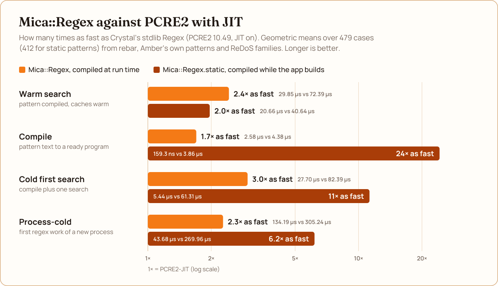
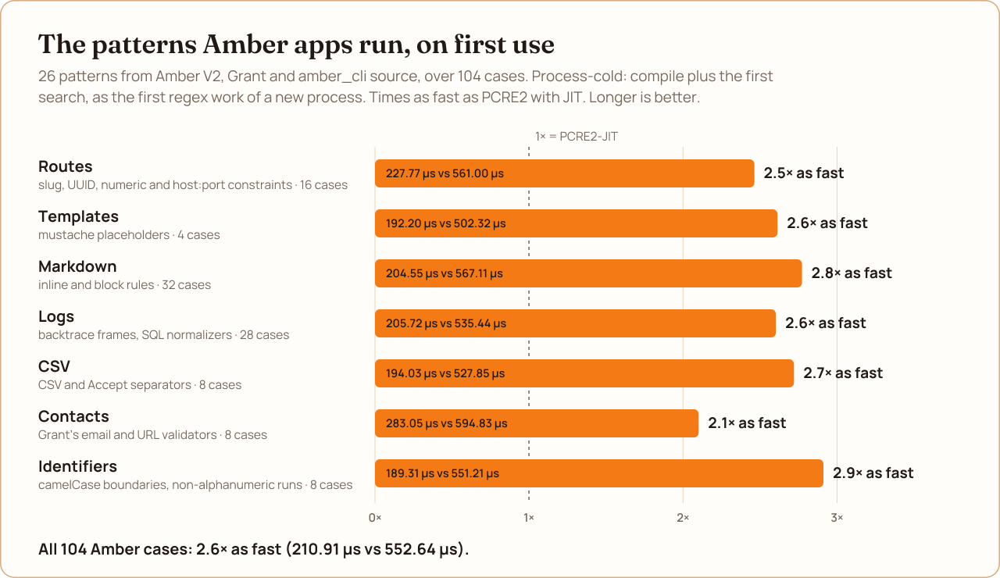
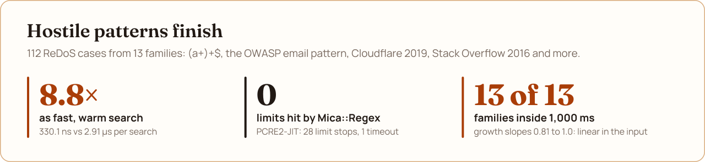
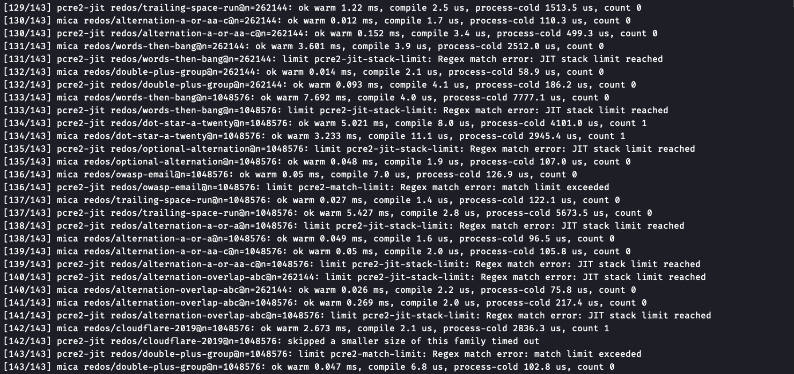
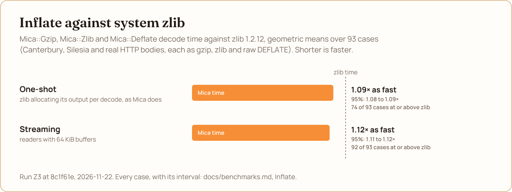
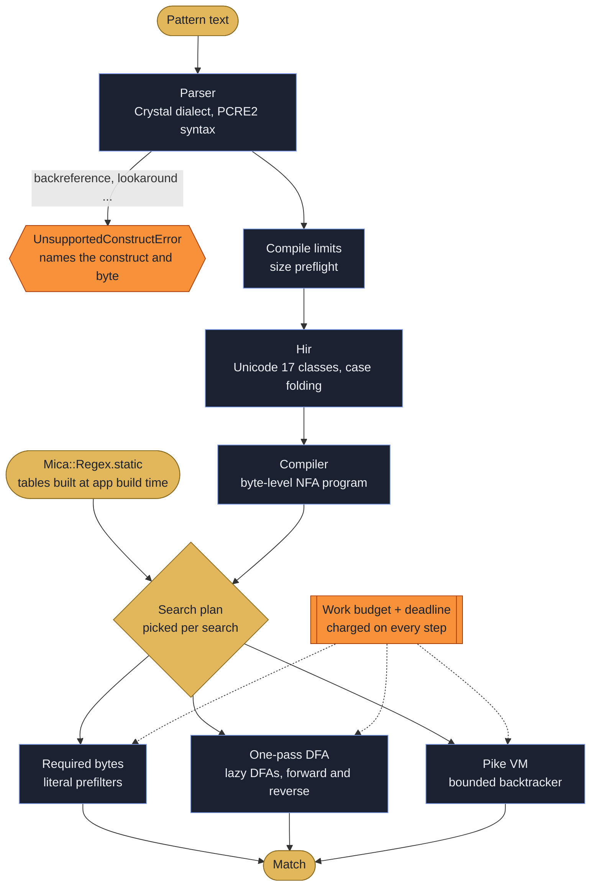

<a href="#install">
  
</a>

<p align="center">
  <picture>
    <source media="(prefers-color-scheme: dark)" srcset="docs/brand/badges-dark.svg">
    
  </picture>
</p>

<p align="center">
  <b>Mica is Amber's pure-Crystal parsing library.</b><br>
  Regex, gzip, zlib, DEFLATE, XML and UTF-8, with a work budget and a deadline on every parse.
</p>

<br>

## Install

```yaml
dependencies:
  mica:
    github: amberframework/mica
    version: 0.2.0
```

```crystal
require "mica"
```

> [!NOTE]
> 0.2.0 has `Mica::Regex` and `Mica::XML`. Inflate (`Mica::Gzip`, `Mica::Zlib`, `Mica::Deflate`) is on `main` and ships in the next release. To use it now, pin the merge commit: `commit: 25b528051464b7ce795478a3519f729eec10b590`.

## Two ways to use it

### 1. Mica's own API, on any Crystal compiler

```crystal
limits = Mica::Regex::SearchLimits::REQUEST
date = Mica::Regex::Expression.new("(?<year>\\d{4})-(?<month>\\d{2})",
  compile_limits: Mica::Regex::CompileLimits::TRUSTED_PATTERN)
date.match("due 2026-11", limits: limits).try(&.["year"]) # => "2026"

# Compiled while the app builds: read-only tables, no allocation per search.
SLUG = Mica::Regex.static(/\A[a-z0-9]+(?:-[a-z0-9]+)*\z/)
SLUG.matches?("pure-crystal-parsing") # => true

body = Mica::Gzip.decode(gzipped, limits: Mica::Deflate::DecodeLimits::REQUEST_BODY, timeout: 2.seconds)
document = Mica::XML.parse(File.read("feed.xml"))
```

`Mica::Regex::Expression` follows stdlib `Regex` method for method, plus the limits. Guides: [Regex](docs/regex.md) · [Inflate](docs/compression.md) · [XML](docs/xml.md).

### 2. Crystal's own `Regex` on Mica, with crystal-alpha

```sh
crystal-alpha build -Duse_mica src/app.cr
```

With `-Duse_mica`, Crystal's own `Regex` (regex literals, `$~`, `String#match`, `gsub`, `scan`, `split`) runs on Mica with no code changes, and the binary links no PCRE2. It arrived in [crimson-knight/crystal#17](https://github.com/crimson-knight/crystal/pull/17) (merged).

> [!IMPORTANT]
> This is opt-in today. PCRE2 stays the default without the flag, and stock Crystal does not have `-Duse_mica`: it needs the crystal-alpha compiler.

## What Mica leaves out, and the rewrite

Mica's searches run in time linear in the input, so it refuses the constructs that need backtracking. `Mica::Regex` raises `UnsupportedConstructError` naming the construct and its byte; under `-Duse_mica`, a regex literal that uses one is a compile error.

| Instead of | Write | Then, in Crystal |
|---|---|---|
| Backreference `(\w+) \1` | `(\w+) (\w+)` | `match[1] == match[2]` |
| Lookahead `\d+(?= USD)` | `(\d+) USD` | use `match[1]` |
| Lookbehind `(?<=\$)\d+` | `\$(\d+)` | use `match[1]` |
| Negative lookahead `\A(?!admin\z)\w+\z` | `\A\w+\z` | `&& name != "admin"` |
| Atomic group `(?>a+)`, possessive `a++` | `a+` | nothing: Mica never backtracks |

The full list (recursion, conditionals, `\K`, verbs, newline conventions) is in [Excluded constructs](docs/regex.md#excluded-constructs).

## Speed

<picture>
  <source media="(prefers-color-scheme: dark)" srcset="docs/brand/regex-speed-dark.svg">
  
</picture>

<picture>
  <source media="(prefers-color-scheme: dark)" srcset="docs/brand/amber-patterns-dark.svg">
  
</picture>

<picture>
  <source media="(prefers-color-scheme: dark)" srcset="docs/brand/redos-dark.svg">
  
</picture>

<details>
<summary><b>See it run: the ReDoS corpus in a terminal</b></summary>
<br>



<sub>`bench/regex/run.sh --quick --corpora redos --engines pcre2-jit,mica`, run on 2026-11-22 at `main` (25b5280). PCRE2-JIT stops on its stack or match limit; Mica finishes all 143 cases.</sub>

</details>

<picture>
  <source media="(prefers-color-scheme: dark)" srcset="docs/brand/inflate-dark.svg">
  
</picture>

Regex numbers come from the full harness at commit `f0bb0f6`, the code tagged v0.2.0; Inflate numbers from the Z1 run merged in #18. How they are measured, and how to rerun them: [docs/benchmarks.md](docs/benchmarks.md).

## How a search runs



Every engine is linear in the input; the plan only picks the fastest one that fits the pattern and the question asked.

## Formats

| Module | Reads | Guide |
|---|---|---|
| `Mica::Regex` | Regular expressions in Crystal's PCRE2 syntax, linear-time | [docs/regex.md](docs/regex.md) |
| `Mica::Gzip`, `Mica::Zlib`, `Mica::Deflate` | gzip (RFC 1952, multi-member), zlib (RFC 1950), raw DEFLATE (RFC 1951); one-shot and streaming | [docs/compression.md](docs/compression.md) |
| `Mica::XML` | XML 1.0 and 1.1 with Namespaces: streaming reader, DOM, builder, XPath 1.0 | [docs/xml.md](docs/xml.md) |
| `Mica::Core` | Strict UTF-8, UTF-16/UTF-32/ISO-8859-1 transcoding, positions, limits, work budgets | [docs/ADDING_A_FORMAT.md](docs/ADDING_A_FORMAT.md) |

More formats (JSON, YAML, CBOR, HTTP/1.1, URIs, multipart, CSV, TOML, Markdown) plug into the same core.

## Safe by default

Mica is built for bytes from strangers: request bodies, uploads, storage listings.

- **Work budgets.** Every parse and search counts its work and stops at its allowance, so no input can buy superlinear time.
- **Deadlines.** A timeout adds a wall-clock limit, checked as the work runs.
- **Limits.** Output size, decompression ratio, entity expansion, nesting depth and pattern size are capped before the bytes they guard are written.
- **No fetching.** Mica never reads the network or the file system while parsing.
- **No C parsers.** A Mica program links only libgc, libiconv and libSystem, which Crystal itself needs (`scripts/check_linkage.sh`).

> [!TIP]
> Each format ships presets for the common jobs, such as `SearchLimits::REQUEST` and `DecodeLimits::REQUEST_BODY`. Start from one and tighten it.

Found a way past a limit? Please report it privately: [SECURITY.md](SECURITY.md).

## Questions

<details>
<summary><b>Why no backreferences or lookaround?</b></summary>
<br>

They need backtracking, and backtracking is what lets one hostile input stall a server (ReDoS). Mica keeps every search linear instead. Each construct has a short rewrite above, usually one capture group and one comparison in Crystal.

</details>

<details>
<summary><b>Does my app still link PCRE2?</b></summary>
<br>

With Mica's own API, Mica adds no PCRE2, but Crystal's stdlib `Regex` still uses it wherever your code or your shards do. Build with crystal-alpha and `-Duse_mica` to move all of it onto Mica and drop the library.

</details>

<details>
<summary><b>I use stdlib <code>XML</code>. How much changes?</b></summary>
<br>

Mostly the name: `XML` becomes `Mica::XML`. Parsing is strict (the first error raises), and nodes are small structs. The differences are listed in [docs/xml.md](docs/xml.md#differences-from-stdlib-xml).

</details>

<details>
<summary><b>Is Inflate as fast as zlib?</b></summary>
<br>

Not yet. One-shot decoding is 1.45× slower than system zlib today, inside the Z1 goal of 2×. Encoders follow in milestone Z2.

</details>

## Development

```sh
shards-alpha install --frozen
crystal-alpha build $(find spec -name '*_spec.cr' | sort) -o bin/specs && bin/specs
crystal-alpha tool format --check
scripts/check_linkage.sh     # no PCRE2, libz or libxml2 in a Mica program
bench/regex/run.sh --quick   # Mica::Regex against PCRE2
bench/deflate/run.sh --quick # Inflate against zlib
```

Fuzzing, conformance suites and the XML benchmarks: [docs/xml.md](docs/xml.md), [docs/regex.md](docs/regex.md), [docs/compression.md](docs/compression.md) and [docs/benchmarks.md](docs/benchmarks.md). Requirement ids in `spec/requirements/*.tsv` map each standard's sections to the specs that cover them.

Something off? [Open an issue](../../issues/new/choose). Questions go to [SUPPORT.md](SUPPORT.md).

## License

MIT. `src/mica/xml/composing_characters.cr` is generated from the Unicode 17.0.0 character data that ships with the Crystal standard library, under the Unicode License v3.

<br>

<p align="center">
  <a href="https://amberframework.org"></a>
</p>
<p align="center"><sub>Part of the <a href="https://amberframework.org">Amber framework</a>. Built and maintained by</sub></p>
<p align="center"><a href="https://agentc.consulting"><picture>
  <source media="(prefers-color-scheme: dark)" srcset="https://raw.githubusercontent.com/AgentC-Consulting/.github/main/brand/wordmark-dark.png">
  
</picture></a></p>
